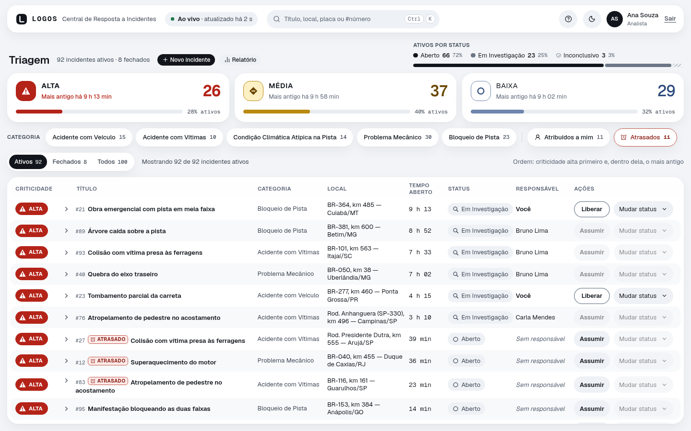
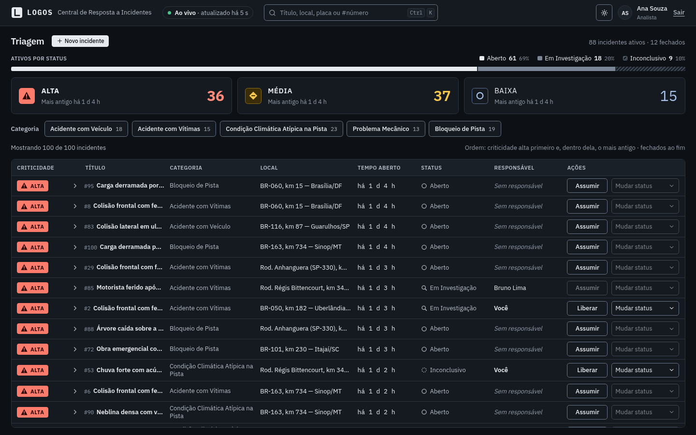
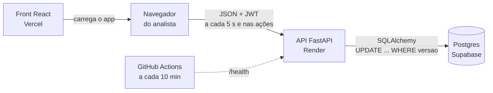

# Logos — Central de Resposta a Incidentes

MVP da central que recebe os incidentes de uma frota de 5.000 caminhões e ajuda o analista a
decidir **o que tratar primeiro**. API em Python (FastAPI + Postgres) e interface em React.

| | |
|---|---|
| **Aplicação** | https://logos-incidentes.vercel.app |
| **API (documentação interativa)** | https://logos-api-uy7z.onrender.com/docs |
| **Vídeo de demonstração** | _link publicado na entrega_ |

**Acesso de demonstração:** usuário `ana`, senha `logos2026` (as credenciais também aparecem na
tela de login). Para ver o controle de concorrência, entre como `bruno` (mesma senha) numa janela
anônima ou em outro navegador e altere o mesmo incidente nas duas.

> A API roda no plano gratuito do Render. Se ela estiver hibernando, o primeiro acesso pode levar
> até 1 minuto; a tela mostra "Acordando o servidor…" enquanto isso.



<details>
<summary>Modo escuro</summary>



</details>

## O que o case pede e como o Logos responde

| Pergunta do case | Resposta | Detalhes |
|---|---|---|
| Como mostrar 100 incidentes e o analista achar a prioridade em milissegundos? | Uma linha por incidente, ordenada por criticidade e, dentro dela, pelo mais antigo. A criticidade usa **cor, ícone e peso da fonte** ao mesmo tempo (legível por daltônicos). Contadores por criticidade no topo. | [ADR 0004](docs/decisoes/0004-priorizacao-visual.md) |
| Gestão por exceção | Os cartões de criticidade e os chips de categoria são filtros; busca por título, local, placa ou `#número`. Cada contador mostra quantos incidentes o filtro traria. Os filtros ficam na URL. | [Filtros](#filtros) |
| Como impedir que dois analistas tratem o mesmo incidente? | **Controle de concorrência otimista** (coluna `versao`) e **responsável**: o analista assume o incidente e só ele muda o status. Quem chega depois recebe **409** com o estado atual, e a tela mostra quem alterou. | [ADR 0002](docs/decisoes/0002-concorrencia-otimista.md) |
| E se a conexão oscilar ou o banco ficar lento? | A tela muda na hora (atualização otimista) e volta sozinha se a API falhar, com aviso e "Tentar de novo". A API tem timeout de consulta, retry com backoff em erro transitório e **503 + `Retry-After`**. O front distingue carregando, erro, vazio, reconectando e "acordando o servidor". | [ADR 0003](docs/decisoes/0003-resiliencia.md) |

## Funcionalidades

- **Triagem:** lista ordenada, contadores por criticidade, barra de status dos ativos, tempo
  aberto relativo e atualização automática a cada 5 s ("Ao vivo · atualizado há 3 s").
- **Desfazer e histórico:** depois de assumir, liberar ou mudar status, "Desfazer" fica 6 s na
  tela (é uma ação nova, com as mesmas regras e a versão atual). Os detalhes de cada incidente
  mostram a linha do tempo: quem registrou, assumiu, mudou o status ou editou, e quando.
- **Ingestão pelos caminhões:** os rastreadores enviam incidentes direto para a API, com chave
  de dispositivo e idempotência (um reenvio não duplica). Ver [Ingestão](#ingestão-pelos-caminhões).
- **Ciclo de vida:** assumir, liberar e mudar status com as transições permitidas. "Fechado" é
  final. Fechar e marcar Inconclusivo pedem um **comentário obrigatório** (como resolveu, ou por
  que parou); liberar aceita um comentário opcional para o próximo analista. O comentário fica no
  histórico. Ações que o analista não pode fazer aparecem desativadas **com o
  motivo** ("Só Bruno Lima pode mudar o status").
- **CRUD completo:** criar, editar e remover incidentes num painel lateral, com validação por campo
  igual à da API. A edição envia só os campos alterados; se outro analista mudou o incidente com o
  painel aberto, o painel mostra quais campos mudaram e deixa escolher entre usar a versão atual
  ou manter as próprias mudanças.
- **Contato do motorista:** cadastro da frota (veículo → motorista atual) e, no incidente, uma
  cópia do contato no momento em que ele foi aberto. Os detalhes trazem "Ligar" e "WhatsApp"; o
  formulário mostra o motorista que será copiado antes de salvar. Telefone é dado pessoal: só sai
  pela API autenticada, e a API não grava o corpo das requisições em log. Na demonstração, os telefones usam o DDD 10, que não
  existe: nenhum número fictício toca o telefone de alguém.
- **Prazo para assumir:** Alta 15 min, Média 60, Baixa 240 (regra da API, em `/regras`). Um
  incidente ativo sem responsável além do prazo ganha o marcador "Atrasado" (texto e ícone, não
  só cor), e o filtro **Atrasados** mostra quantos são e quais.
- **Gestão por exceção ao vivo:** "Atribuídos a mim" mostra a fila do analista; quando chega um
  incidente Alta novo, um aviso leva até ele, a linha fica destacada e, com a aba em segundo
  plano, o título conta os novos ("(2) Logos").
- **Apoio à decisão nos detalhes:** o protocolo sugerido da categoria (ex.: Acidente com
  Vítimas → SAMU 192 e Bombeiros 193 antes de tudo), "Abrir no mapa" no local do incidente e
  **Mesma placa**: os outros incidentes do caminhão, ativos e fechados (problema recorrente
  indica manutenção).
- **Ajuda dentro do app:** o botão "?" abre o guia "Como funciona a triagem", oferecido também
  no primeiro acesso, para usar o sistema sem instrução externa.
- **Celular e tablet:** abaixo de 1024 px, cada incidente vira um cartão com as mesmas ações,
  detalhes e avisos da linha da tabela, sem rolagem horizontal.
- **Movimento com propósito:** as linhas deslizam até a nova posição quando a ordem muda, a ação
  pendente brilha até o servidor confirmar e o tema troca num círculo a partir do botão. O
  [mapa de animações](docs/mapa-motions.md) explica cada uma e o que ficou de fora.
- **Modo claro e escuro** com transição suave, seguindo o sistema até o analista escolher. Os dois
  temas passam no contraste WCAG AA (verificado por teste automático).
- **Acessibilidade:** navegação por teclado, foco visível, lista com semântica de tabela (ou de lista, no celular),
  anúncios para leitor de tela e `prefers-reduced-motion` respeitado. Atalhos: `Ctrl+K` ou `/` levam à busca.

## Arquitetura



```
api/                FastAPI
  app/routers/      rotas HTTP (auth, incidentes, health)
  app/schemas/      validação de entrada e saída (Pydantic)
  app/services/     regras de negócio: ciclo de vida, versão, responsável
  app/models/       tabelas (SQLAlchemy)
  app/core/         configuração, banco, segurança, erros, resiliência, limite de login
  app/seed/         analistas e 100 incidentes de demonstração
  alembic/          migrations
  tests/            pytest (123 testes)
  scripts/          simulador de caminhão para a ingestão
web/                React + Vite + TypeScript
  src/api/          cliente tipado da API, erros e sessão
  src/features/     auth (login) e incidents (triagem, filtros, ações, formulário)
  src/components/   componentes compartilhados e shadcn/ui
  src/theme/        tema claro/escuro
docs/
  decisoes/         ADRs: contexto, decisão, alternativas e consequências
  contrato-api.md   rotas, códigos de erro e ciclo de vida
  mapa-motions.md   mapa de animações: princípios, onde cada movimento ajuda e o que ficou fora
```

### Escolhas e por quê

| Camada | Escolha | Por quê |
|---|---|---|
| API | **FastAPI + Pydantic v2** | Validação declarada no schema (enums fechados, tamanhos, campos extras recusados), erro 422 estruturado e OpenAPI em `/docs` sem código extra. |
| Dados | **SQLAlchemy 2 + Alembic + Postgres** | `UPDATE ... WHERE id = :id AND versao = :v` explícito para o controle otimista; migrations versionadas; transações reais. |
| Estado no front | **TanStack Query** | Cache, leitura periódica, retry com backoff e estado das mutações; a atualização otimista é aplicada **por cima** da lista confirmada, então a leitura de 5 s nunca apaga uma ação em andamento e uma falha nunca desfaz outra linha. |
| UI | **Tailwind + shadcn/ui (Radix)** | Tokens de cor em variáveis CSS (tema claro/escuro num lugar só) e menus, diálogos e painel acessíveis por teclado. |
| Testes | **pytest e Vitest + Testing Library** | Testes de regra (versão, transições, validação) e de tela (otimista, rollback, 409, filtros, formulário). |
| Deploy | **Vercel + Render + Supabase** | Planos gratuitos que continuam no ar durante a avaliação; o Postgres do Render expiraria em 30 dias. API e banco na mesma região (Virgínia): a lista responde em ~0,3 s ([ADR 0006](docs/decisoes/0006-deploy-e-ambientes.md)). |

As justificativas completas, com as alternativas descartadas, estão em
[`docs/decisoes/`](docs/decisoes/).

### Concorrência, passo a passo

1. Ana e Bruno veem o incidente #12 na versão 4.
2. Ana clica em **Assumir**. A linha muda na hora; a API grava com `WHERE versao = 4` → versão 5.
3. Bruno clica em **Assumir** antes da próxima leitura. A API não acha a versão 4 → **409** com o
   estado atual.
4. A tela do Bruno mostra "Ana Souza alterou este incidente. Agora está Em Investigação, com Ana
   Souza" e o botão passa a dizer o motivo do bloqueio.

Nenhum lock de banco fica preso durante a requisição, e o mesmo mecanismo vale para editar,
mudar status, liberar e remover.

### Filtros

- Os filtros rodam **no front** sobre a lista completa: com 100 incidentes, filtrar é instantâneo e
  cada contador pode mostrar quantos itens o filtro traria sem nova chamada à API.
- O estado fica na **URL** (`?criticidade=alta&categoria=acidente_vitimas&busca=br-116`): recarregar
  ou compartilhar o link mantém a visão.
- A triagem mostra só os **ativos**. O seletor **Ativos / Fechados / Todos** traz o que já foi
  resolvido: em "Fechados", o fechado mais recente vem primeiro e a coluna "Tempo aberto" mostra
  quanto o incidente ficou aberto até fechar.
- A API também aceita os mesmos filtros (`GET /incidentes?criticidade=alta&status=aberto`), para
  quando o volume não couber mais em uma lista.

### Regras numa fonte só

O front repete algumas regras para explicar um bloqueio antes do clique ("só o responsável
muda o status") e validar o formulário antes de enviar. Para as cópias não se afastarem da API,
o módulo `app/regras.py` **deriva** as regras do próprio código (ciclo de vida e schema
Pydantic), publica em `GET /regras` e gera o `web/src/api/regras.json` que o front lê. Um teste
da API falha se o JSON divergir do código, e um teste ponta a ponta compara a API rodando com o
front publicado.

### Segurança básica da API

- **JWT** (HS256, 8 h) em todas as rotas, exceto login e `/health`; senhas com **bcrypt**.
- **Limite de login** por IP (5/min, IP real via Cloudflare) e por usuário (5 erros/min). O login
  leva o mesmo tempo com usuário existente ou não.
- **Validação** em todas as entradas; erros padronizados, sem stack trace nem SQL.
- **CORS** restrito ao domínio do front; **CSP** e cabeçalhos de segurança no site.
- **Segredos** só em variáveis de ambiente; banco com usuário próprio, sem superusuário, em schema
  fora da API pública do Supabase.

Detalhes e a revisão de segurança feita antes da entrega: [ADR 0005](docs/decisoes/0005-seguranca.md).

## Como rodar localmente

Pré-requisitos: [uv](https://docs.astral.sh/uv/), Node.js 20+ e Docker (só para o Postgres local).

```bash
# 1. Banco (Postgres 17 na porta 55432)
docker compose up -d

# 2. API em http://localhost:8000
cd api
cp .env.example .env            # já aponta para o Postgres do passo 1
uv sync
uv run alembic upgrade head     # cria as tabelas
uv run python -m app.seed       # analistas ana e bruno + 100 incidentes
uv run uvicorn app.main:app --reload

# 3. Front em http://localhost:5173 (em outro terminal)
cd web
cp .env.example .env
npm install
npm run dev
```

Entre com `ana` / `logos2026`. Sem Docker, aponte `DATABASE_URL` no `api/.env` para outro
Postgres (o projeto usa a versão 17 localmente e o Postgres do Supabase em produção).

### Testes e qualidade

```bash
cd api && uv run pytest && uv run ruff check .        # 123 testes
cd web && npm test && npm run lint && npm run build   # 272 testes
```

Os testes da API rodam num schema temporário, criado e apagado a cada execução.

**Ponta a ponta (Playwright):** navegador de verdade contra a API e o Postgres de verdade, em 9
cenários — triagem e filtros, login, dois analistas no mesmo incidente (409), CRUD com dado
inválido barrado, rollback com falha na escrita, desfazer e histórico, ingestão pelo caminhão
aparecendo na triagem, paridade das regras entre a API rodando e o front e a tela de celular
(cartões, sem rolagem horizontal).

```bash
docker compose up -d
cd api && uv run alembic upgrade head && uv run python -m app.seed --recriar
cd web && npm run build && npm run e2e     # sobe a API e o front sozinho
```

O CI (GitHub Actions) roda tudo a cada push: API, front e os testes ponta a ponta, estes com um
Postgres descartável do próprio job.

### Simular banco lento e falhas

Para ver os estados de carregamento e o rollback, suba a API com:

```bash
SIMULAR_LATENCIA_MS=1500 SIMULAR_FALHA_PCT=30 uv run uvicorn app.main:app --reload
```

A latência vale para as rotas de incidentes; a falha faz 30% das escritas responderem 503 antes de
gravar. As duas ficam desligadas por padrão.

## Ingestão pelos caminhões

Os incidentes também chegam direto dos rastreadores, sem analista
([ADR 0008](docs/decisoes/0008-ingestao-pelos-caminhoes.md)). Cada caminhão usa uma chave de
dispositivo, e todo envio leva um `Idempotency-Key`: se a rede oscilar e o rastreador reenviar,
a API devolve o mesmo incidente (200) em vez de criar outro.

```bash
cd api
uv run python scripts/simular_caminhao.py --criticidade alta          # API local
uv run python scripts/simular_caminhao.py --api https://logos-api-uy7z.onrender.com
```

```
1º envio → 201 Created: incidente #102 (alta) Tombamento de carreta na serra
Reenvio com a mesma Idempotency-Key → 200: incidente #102
Sem duplicata: o reenvio devolveu o mesmo incidente.
```

Com a triagem aberta, o incidente aparece em até 5 s, com o aviso de Alta novo, o ícone de
caminhão na linha e "Recebido de …" no histórico. O dispositivo de demonstração (chave
`demo-caminhao-logos-2026`) é criado pelo seed; dispositivos reais recebem uma chave aleatória
por `uv run python -m app.dispositivos criar "Caminhão 042" --placa ABC1D23`.

## API

| Método | Rota | O que faz |
|---|---|---|
| `POST` | `/auth/login` | Devolve o token |
| `GET` | `/auth/eu` | Analista do token |
| `GET` | `/incidentes` | Lista em ordem de triagem (filtros opcionais) |
| `POST` | `/incidentes` | Cria |
| `GET` · `PATCH` · `DELETE` | `/incidentes/{id}` | Detalha, edita, remove (`versao` obrigatória para alterar) |
| `POST` | `/incidentes/{id}/assumir` · `/liberar` · `/status` | Ciclo de vida, com `versao` |
| `GET` | `/incidentes/{id}/eventos` | Histórico, gravado na mesma transação de cada alteração |
| `POST` | `/ingestao/incidentes` | Envio direto pelo caminhão (chave de dispositivo + `Idempotency-Key`) |
| `GET` | `/veiculos/{placa}` | Veículo da frota e o motorista atual (com login: telefone é dado pessoal) |
| `GET` | `/regras` | Transições, limites dos campos e padrão da placa, derivados do código |
| `GET` | `/health` | API e banco respondendo |

Erros sempre no formato `{"erro": {"codigo", "mensagem", ...}}`. Contrato completo, códigos de
erro e transições permitidas: [`docs/contrato-api.md`](docs/contrato-api.md).

## Limitações conhecidas

- **Atualização por polling (5 s), não por WebSocket.** O 409 cobre o intervalo entre leituras;
  com muitos analistas, um canal de eventos economizaria requisições.
- **Sem paginação nem virtualização da lista.** Para 100 incidentes não faz diferença; para
  milhares, a API já filtra, mas a lista precisaria paginar.
- **Token no `localStorage`.** Mitigado por CSP e ausência de HTML injetado; em produção real, o
  ideal é cookie `HttpOnly` no mesmo domínio.
- **Limite de login em memória.** Vale para uma instância da API; com várias, precisaria de Redis.
- **Hibernação do plano gratuito.** Um job agendado chama `/health` a cada 10 min, mas o
  primeiro acesso ainda pode esperar o servidor acordar.

## Próximos passos

Ideias que ficaram fora do MVP estão na issue
[#25](https://github.com/HeitorM50/logos-incidentes/issues/25):

- **Eventos em tempo real (SSE)** no lugar da leitura a cada 5 s, quando o número de analistas
  justificar o custo.
- **Sugestão de criticidade por IA** no formulário de criação, sempre confirmada pelo analista.
